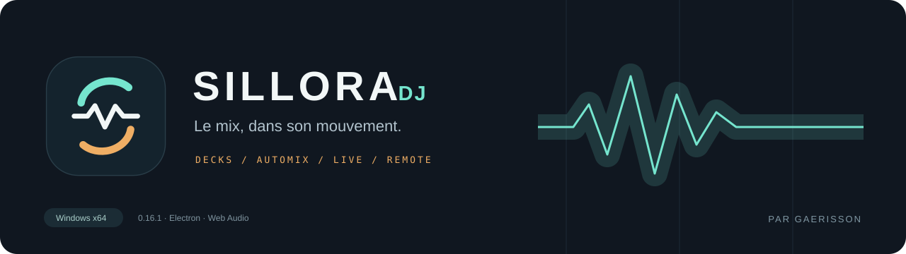
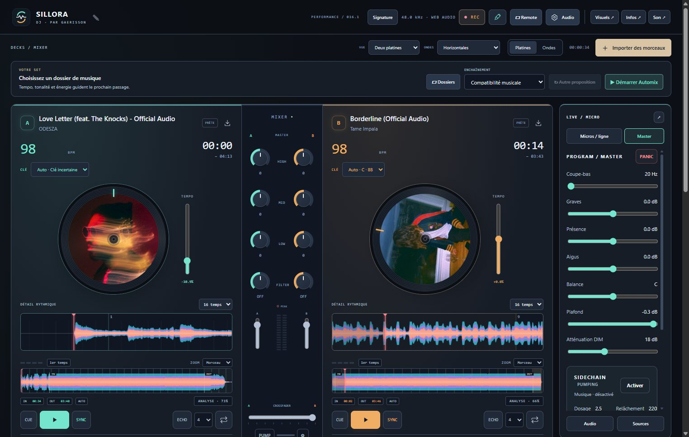
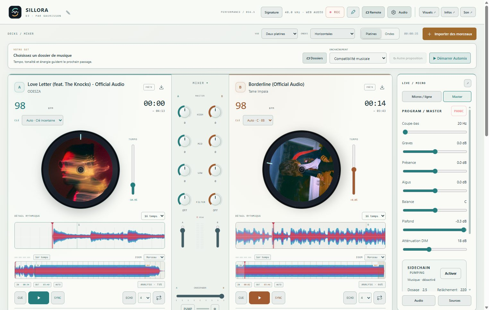
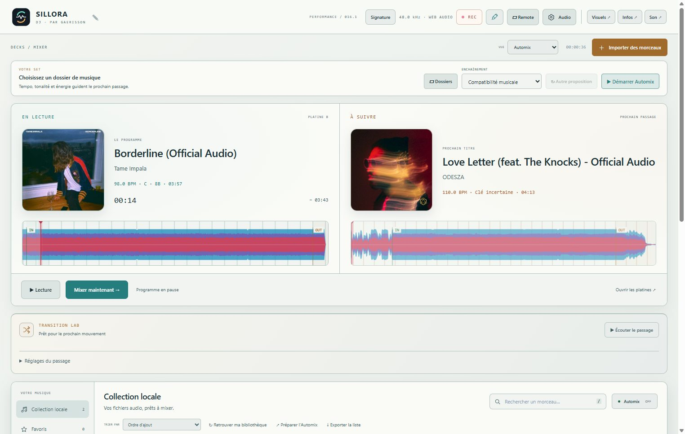
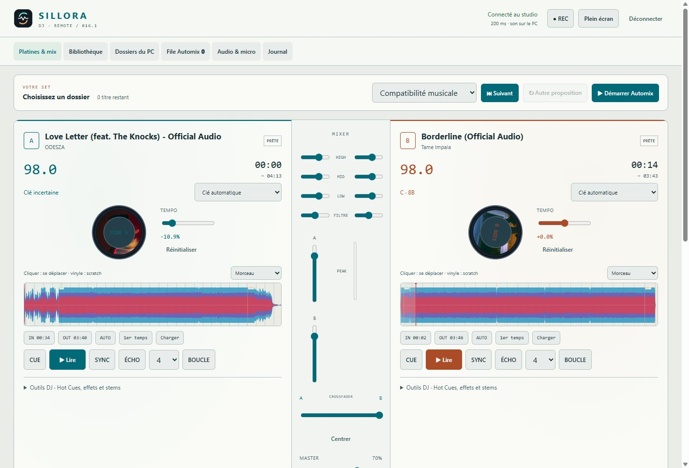
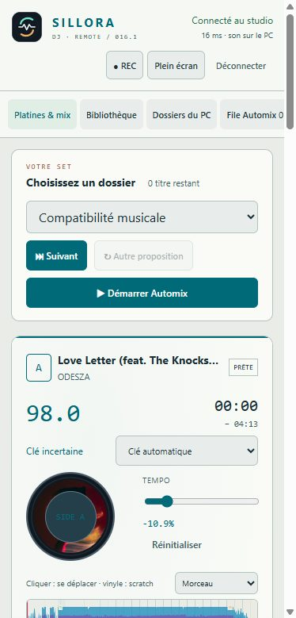

<p align="center"></p>

<p align="center"><strong>Console DJ &amp; régie live pour Windows</strong><br>Deux platines, Automix, stems et télécommande Web.<br><sub>Version de développement 0.21.0 · Par Gaerisson</sub></p>

<p align="center"><a href="#le-studio">Découvrir</a> · <a href="docs/SCREENSHOTS.md">Galerie</a> · <a href="#prise-en-main">Démarrer</a> · <a href="#feuille-de-route">Feuille de route</a> · <a href="#validation-et-limites-actuelles">État &amp; limites</a></p>



## Le studio

**Sillora DJ** réunit le mixage d’une collection locale et la gestion d’une petite régie dans une même application. Développé par **Gaerisson**, le projet vise une lecture continue et des transitions adaptées au rythme, à la tonalité et à l’énergie des morceaux.

La priorité de la refonte est le **résultat audio**, puis la stabilité, l’ergonomie et la finition visuelle. Les fonctions ci-dessous sont présentes dans la version actuelle ; les évolutions de la feuille de route restent à implémenter et à valider.

### Fonctions présentes en 0.21.0

| Mixer | Préparer et diffuser |
| :--- | :--- |
| Deux platines, pochettes et ondes RGB déroulantes | Bibliothèque par dossiers, favoris et tri BPM / clé |
| Scratch à la souris, Hot Cues, boucles et beat jump | Suggestions dans le dossier du set et file Automix |
| Transitions par filtres, EQ, échos et textures | Variation commune du tempo pendant les passages |
| Sidechain léger activable et réduction visible | Quatre entrées micro / ligne et autoduck configurable |
| Stems voix, batterie, basse et instruments | Gate, compresseur, EQ, limiteur et filtres anti-larsen |
| Sampler huit pads et enregistrement du programme | Remote Web, visuels et fenêtres média séparées |

La **0.18.0** ajoute des mesures audio L/R indépendantes au master et avant le crossfader de chaque platine, avec RMS, crête, maintien et témoin de saturation. Elles sont partagées avec Remote. Un maintien de secours avec microfondus protège la lecture pendant une préparation tardive ; un set terminé se termine normalement. [Notes et limites du lot](docs/CHANGELOG-0.18.0.md).

La **0.19.0** sépare le catalogue du décodage : les fichiers apparaissent immédiatement, les platines passent en priorité et l’import peut être suspendu, annulé ou repris. Cache natif par contenu, réanalyse préservant les corrections et pagination à 100 lignes complètent ce lot. [Notes et recette](docs/CHANGELOG-0.19.0.md).

La **0.20.0** coordonne volumes, graves, filtre et écho sur une partition commune. Les montées gardent le groove avant un relais mesuré, et les repères d’onde suivent le temps réellement parcouru pendant le changement de tempo. [Notes et recette](docs/CHANGELOG-0.20.0.md).

La **0.21.0** ajoute le profil de maintien de hauteur **Rythme** dans **Régie → Master**, également pilotable sur Remote. Sur le banc de pulsations, sa latence de traitement est d’environ 59 ms et l’écart maximal par corrélation passe de 13 à 5 ms. Standard reste le profil par défaut ; le timbre doit être jugé à l’écoute. [Mesures, utilisation et limites](docs/KEYLOCK-0.21.md).

### Un passage construit autour de la musique

Le sélecteur Automix actuel utilise le tempo mesuré, la grille, l’énergie, la tonalité estimée et l’historique des effets pour proposer un passage. Le tempo progressif fait évoluer les deux platines ensemble, puis laisse le titre entrant à sa vitesse native. **Mixer maintenant** permet de demander le relais.

Le premier lot ajoute une surveillance Automix dédiée, la lecture dès le décodage et une analyse en arrière-plan avec cache par contenu. Le panneau **Régie** est masqué par défaut et peut être rouvert depuis l’en-tête.

Le catalogue actuel propose notamment fondu, filtre, échange de graves, Echo Out, Whoosh, Sweep et transitions à stems. Leur présence ne signifie pas que leur qualité musicale est acquise : le calage, le déclenchement au point OUT et le rendu des effets font partie des priorités de correction.

Le bouton **PUMP** ajoute un sidechain discret sur les attaques graves de la musique. Son dosage, son relâchement et sa détection restent réglables ; le micro conserve son propre traitement.

[Comprendre l’Automix](docs/AUTOMIX-0.16.md) · [Les familles de transitions](docs/TRANSITIONS-0.16.md)

## Une interface à votre couleur

<table><tr><td width="50%"><br><strong>Porcelaine</strong> — la même console en clair.</td><td width="50%"><br><strong>Automix</strong> — préparer le prochain passage.</td></tr></table>

Pseudo, logo, couleurs, motifs et intensité des visuels se règlent dans **Signature**. Les fenêtres Visuels, Média et Son peuvent s’ouvrir séparément.

### Le contrôle reste à portée de main

<table><tr><td width="75%"><br><strong>Remote Web</strong> — platines, bibliothèque, sampler et régie.</td><td width="25%"><br><strong>Mobile</strong> — le son continue de sortir du PC.</td></tr></table>

Captures de l’application exécutée avec des fichiers audio réels. Les fichiers musicaux et réglages personnels ne sont pas distribués. [Voir la galerie](docs/SCREENSHOTS.md).

## Prise en main

1. Ouvrir **Dossiers** ou **Importer des morceaux**.
2. Charger un titre sur chaque platine, ou choisir **Automix ici** dans un dossier.
3. Sélectionner un passage dans **Transition Lab**, puis **Mixer maintenant**.
4. Ouvrir **Master** pour le sidechain, **Micros / ligne** pour la régie et **Remote** pour l’appairage sur le réseau local.

Le build produit `Sillora-DJ-Setup-0.21.0.exe` et `Sillora-DJ-0.21.0-Windows.exe`. **Les binaires ne sont pas encore publiés dans GitHub Releases.** Pour démarrer depuis les sources :

```powershell
npm ci
npm run vendor:audio
npm start
```

Node.js 24 est utilisé pour le développement. `npm run dev` démarre le lecteur dans le navigateur ; les fichiers natifs, imports et stems utilisent Electron. [Installation et construction Windows](docs/INSTALLATION.md).

## Feuille de route

La refonte est organisée dans cet ordre. La **0.17.0 livre un premier lot de fiabilité et de préparation**, décrit dans les [notes de version](docs/CHANGELOG-0.17.0.md) et le [suivi des travaux](PROGRESS.md). Les objectifs complets ci-dessous ne sont pas tous livrés.

La [revue complète du cahier des charges](docs/AUDIT-REFONTE.md) classe **374 points** avec leurs preuves, écarts et validations restantes sur la base 0.17.0. Le [suivi actualisé](docs/AUDIT-SUIVI.md) détaille les lots 0.18–0.21 et les points encore ouverts. La [proposition de refonte UI](docs/REFONTE-UI.md) comprend des captures et une [maquette interactive locale](design/refonte/README.md) : Studio, Automix, Préparation et Régie. Il s'agit d'une proposition à données illustratives ; la maquette ne pilote pas le moteur audio de la 0.21.0.

| Priorité | Objectifs | Validation attendue |
| :--- | :--- | :--- |
| **1 · Fiabilité audio** | Horloge audio commune, commandes et boucles immédiates ou quantifiées, préparation avant OUT, relais de secours | Lecture continue, absence de silence ou clic involontaire, mesures de latence et de dérive |
| **2 · Analyse & bibliothèque** | Import non bloquant, analyses prioritaires en arrière-plan, cache persistant versionné, préparation du prochain titre | Import et analyse pendant la lecture, reprise après redémarrage, absence de recalcul inutile |
| **3 · Automix musical** | Planificateur distinct de l’exécution, phrases et points de passage, compatibilité rythmique/harmonique, courbes de tempo et échanges de basses | Comparaisons de rendus audio entre BPM proches ou éloignés, transitions au bon moment et continuité au point OUT |
| **4 · Audio avancé** | Préparation anticipée des stems, scratch vinyle et waveform, sidechain configurable, VU-mètres L/R en dBFS avec peak hold | Mesures du signal réel, transitions avec et sans stems, réponse du scratch et des boucles |
| **5 · Interface & Remote** | Modules affichables, panneau micro masqué par défaut, ondes fluides, vinyles proportionnés, visualisations séparées pour écran externe, copie du lien Remote fiable | Contrôle local/distant cohérent, affichage synchronisé avec l’audio, adaptation aux tailles d’écran |
| **6 · Distribution** | File d’import de playlists, détection des doublons, mises à jour vérifiées et migrations préservant les données | Installation et récupération testées, aucune mise à jour interrompant une session |

### Transitions et modes visés

Les familles à construire ou approfondir sont **Smooth Beatmatch**, **EQ / Bass Swap**, **Build & Drop**, **Tempo Morph**, **Echo Out / Filter Sweep**, **Spinback / Vinyl Brake**, **Beat Roll / Loop** et **Stems Fusion**. Les presets peu convaincants, dont Tremolo, doivent quitter la sélection par défaut ; les effets manuels réutilisables peuvent rester disponibles.

Les modes **Smart**, **Smooth**, **Club**, **Festival**, **Creative** et **Custom**, avec intensité réglable, sont prévus dans cette refonte. La détection avancée des phrases, voix, buildups et drops reste un objectif : le sélecteur actuel repose sur des estimations et des heuristiques.

Une transition devra être préparée en amont, démarrer sur un repère musical pertinent, maîtriser les basses et les niveaux, puis laisser le morceau entrant poursuivre sa lecture. Un souffle suivi d’un changement de titre ne suffit pas à valider un passage avancé.

## Validation et limites actuelles

Version **0.21.0**, Windows x64, Electron et Web Audio. La dernière suite locale enregistrée compte **261 tests réussis**. **48 scénarios natifs passent depuis le paquet Windows** : 16 cas acoustiques, quatre PC/Remote, 18 rendus musicaux avec les deux profils, six bibliothèque et quatre continuité/audio. Les 136 sources applicatives correspondent au code embarqué ; installateur et portable ont le même contenu vérifié. Les détails et empreintes sont consignés dans les [notes de version](docs/CHANGELOG-0.21.0.md). Ces vérifications techniques ne constituent pas une validation d’écoute de tous les presets ni une garantie de stabilité sur de longues sessions.

Le premier lot corrige la préparation au point OUT, les sources entrantes après annulation, la sortie de boucle après variation du tempo et la copie native du lien Remote. L’analyse fonctionne en arrière-plan pendant la lecture. La 0.18 ajoute des microfondus aux raccords du secours. La 0.19 valide six scénarios de bibliothèque sous Electron, dont une reprise après changement de port, et rejoue quatre scénarios audio/Remote sur deux vrais MP3. La gestion de très grandes collections, les préparations de stems et les sessions prolongées restent à approfondir.

- BPM, tonalités et repères IN/OUT : estimations modifiables.
- Stems précalculés sur CPU ; runtime et modèle embarqués dans les distributions préparées, hors du dépôt source.
- YouTube et SoundCloud : import de liens publics compatibles ; catalogue abonné SoundCloud Go+ non intégré.
- ASIO, MIDI et préécoute casque séparée non proposés dans cette version. Les réglages anti-larsen dépendent de la salle.
- Les mises à jour automatiques et les nouveaux modes décrits dans la feuille de route ne sont pas encore livrés.

La validation de chaque lot devra préciser les fonctions testées, les mesures disponibles, les résultats d’écoute et les limites restantes. Les fichiers musicaux et enregistrements de test personnels restent hors du dépôt.

## Documentation et contributions

[Installation](docs/INSTALLATION.md) · [Galerie](docs/SCREENSHOTS.md) · [Identité visuelle](docs/BRAND.md) · [Version 0.21](docs/CHANGELOG-0.21.0.md) · [Suivi de l’audit](docs/AUDIT-SUIVI.md) · [Données & réseau](docs/PRIVACY.md) · [Dépendances](THIRD_PARTY.md)

Un bug, une transition à améliorer ou une idée ? [Ouvrir une issue](https://github.com/Gaerisson/Sillora-DJ/issues/new/choose) ou consulter [le guide de contribution](CONTRIBUTING.md). Pour un problème audio, préciser la version, les réglages, le point de déclenchement et les étapes permettant de le reproduire.

## Crédits

**Sillora DJ** est développé par **Gaerisson**, avec assistance IA / vibe coding, notamment avec **ChatGPT d’OpenAI**. Le copyright du projet appartient à Gaerisson. Les auteurs et licences des dépendances sont conservés dans [THIRD_PARTY.md](THIRD_PARTY.md).

---

**Sillora DJ — par Gaerisson.** © 2026 Gaerisson. [Dépôt GitHub](https://github.com/Gaerisson/Sillora-DJ).
