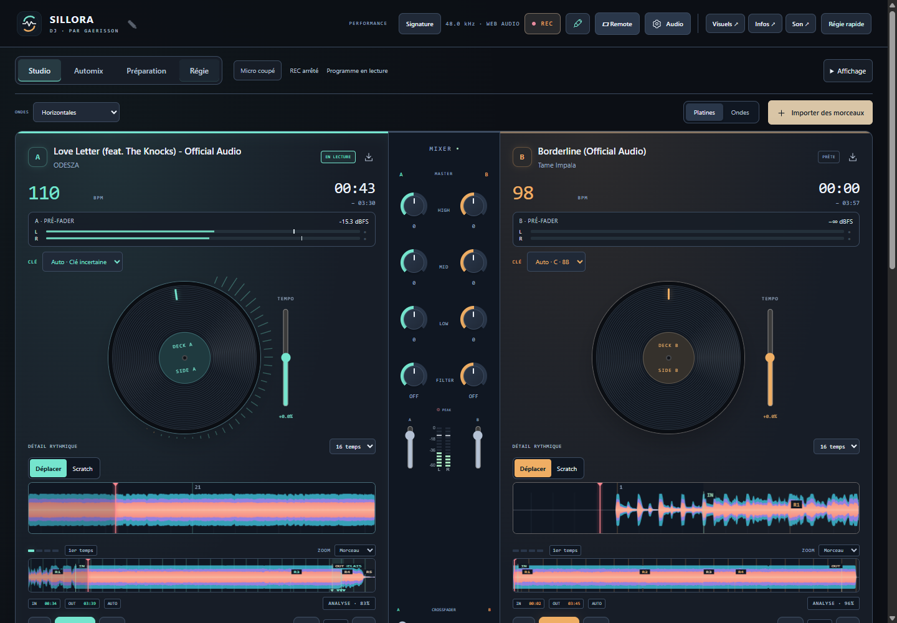

# Sillora DJ 0.28.0 — espaces et vérifications regroupées

Quatre chantiers d’interface sont réunis : navigation **Studio / Automix / Préparation / Régie**, liste musicale redimensionnable, densité de liste et modules mémorisés. Les composants pilotent le moteur existant. Le lot ajoute également un lanceur de recettes et une compilation rapide. [Utilisation](WORKSPACES-0.28.md) · [Recettes et build](QA-BATCH.md).

## Comportement livré

- Navigation au clavier et à la souris, avec maintien de la source audio, état micro/REC/programme visible et retour au choix de régie latérale du Studio.
- Préparation reliée aux pistes chargées, au véritable éditeur de grille et aux réglages/préparation des stems ; Régie complète utilisant les quatre entrées existantes.
- Poignée de hauteur à la souris/toucher et au clavier, annulation par Échap, limite selon le viewport et restauration des préférences sans autoplay.
- Confort/Compacte pour les lignes, affichage des vinyles, sampler et file/journal sans démonter les sources audio. Espacement des dossiers amélioré.
- Lanceur commun : tests unitaires et une console Electron en parallèle, ressource UI partagée et mesures sensibles exclusives. Reprise conditionnée par les empreintes et les rapports.
- Build rapide au niveau de compression 1 : mêmes sources/ressources, fichier plus volumineux. Le mode normal reste disponible.

## Vérification

**353 tests unitaires et 51 cas natifs passent.** Les tests unitaires ciblent les sources ; les 51 cas natifs sont rejoués depuis le paquet final.

| Périmètre natif | Cas |
| :--- | ---: |
| Espaces, poignée réelle, clavier, préférences et Remote | 12 |
| Arrivée au relais, option et Remote | 6 |
| Grille, corrections, persistance et conflits | 9 |
| Gestes d’onde et Remote | 10 |
| Continuité audio | 4 |
| Whoosh/automatique sur les deux MP3, dans les deux sens | 4 |
| Bibliothèque et cache | 6 |

Le banc d’espaces conserve la même AudioBufferSource en lecture pendant la navigation. Ses 24 combinaisons (quatre espaces, trois tailles, deux thèmes) passent à 1440/1280/480 px. Le test de Régie sélectionne les entrées sans demander l’ouverture d’un micro ; il ne remplace pas une mesure acoustique.

Les premiers essais de parallélisme ont dépassé le délai initial de 60 s d’analyse, puis reproduit une erreur de capture GPU et une commande Remote expirée avec deux consoles simultanées. Le banc accepte désormais jusqu’à 180 s pour les seules analyses initiales concernées ; les seuils de continuité et de réactivité restent inchangés. Sur ce PC, les consoles partagent une ressource d’exécution et les tests Node tournent à côté. Les échecs initiaux sont conservés localement. Cette politique n’affirme pas un gain de vitesse garanti sur toute machine.

Les scénarios de gestes, audio, rendus et bibliothèque passent seuls parmi les recettes. Les rapports conservent leurs profils, horodatages, empreintes et éventuelle réutilisation. Les fichiers musicaux, profils et preuves privées restent hors du dépôt. Le moteur de séparation n’étant pas modifié, sa recette neuronale 0.27 n’est pas recomptée comme une nouvelle exécution ; les tests de cycle de vie restent dans la suite unitaire.

## Distribution

158 sources comparées à app.asar, ressources et versions vérifiées ; contenu identique dans les deux exécutables et intégrité de 7 215 fichiers contrôlée. Compilation rapide observée : 239 secondes. Ce temps décrit cette exécution, sans comparaison normalisée au build précédent.

| Fichier | Octets | SHA-256 |
| :--- | ---: | :--- |
| Sillora-DJ-Setup-0.28.0.exe | 360410141 | 9dbec34c329ad86cbf2da537ebebc38bb5e2c06d502b9108184c3414b47070d0 |
| Sillora-DJ-0.28.0-Windows.exe | 360168136 | e9e0c0050028eae2ea87423d7f34b8c214a3119f02249a8cb53bfb9cc899ba84 |

Exécutables préparés localement, sans installation sur le profil personnel ni publication dans GitHub Releases. Relecture par l’auteur ; aucune revue indépendante déclarée.

## Limites

La refonte complète reste progressive : contrôles historiques et couches CSS sont encore présents, la liste n’est pas une bibliothèque virtuelle de taille illimitée et les préférences de disposition restent locales au PC. Le DSP sonore ne change pas dans ce lot. Reconnaissance sémantique, qualité d’écoute des transitions, morceaux complets/longues sessions, quota disque et validation acoustique micro restent dans le [suivi d’audit](AUDIT-SUIVI.md).
