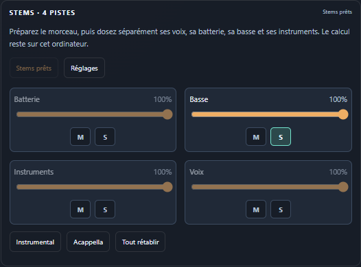

# Sillora DJ 0.29.0 — mixage et cache des stems

Les quatre groupes disposent de **Mute / Solo**, avec faders conservés et presets atomiques PC/Remote. Le cache disque possède un écran de taille/protection, un quota et un nettoyage des résultats inactifs. Le lanceur vérifie aussi le contenu de ses fichiers d’entrée et la syntaxe des recettes avant de lancer Electron.

## Comportement livré

- Gains avec rampe de 20 ms, solos cumulables et priorité du mute. Aucun redémarrage de la source pour ces commandes ; retour aux réglages après une nouvelle préparation ou un scratch.
- Instrumental, Acappella et Tout rétablir appliqués en une fois ; un seul message pour chaque preset Remote, avec identité de piste.
- Cache géré v2 : quota de 1/4/16/32 Gio, défaut 16 Gio, ordre de dernier accès, protection du travail actif et des résultats récemment livrés/lus pendant deux minutes.
- Nettoyage ciblé des noms générés, sans suppression récursive. Modèle, originaux, fichiers étrangers, dossiers non reconnus et liens sont conservés. Quota souple en présence de protections.
- Opérations de disque sérialisées, budget enregistré et relu au redémarrage. L’affichage mémoire de bibliothèque parle désormais de PCM, incluant les stems décodés.
- Identité des recettes enrichie par les empreintes des fichiers musicaux/fixtures et de l’environnement de test déclaré. Un fichier remplacé au même chemin ne réutilise plus un ancien succès. Précontrôle de syntaxe des scripts natifs.

[Commandes et portée](STEM-MIX-0.29.md) · [Cache et protections](STEM-CACHE-0.29.md).

## Vérification

**369 tests unitaires passent.** Le lot source comporte 52 cas natifs ; **42 cas sont ensuite rejoués depuis le paquet final**, avec comparaison des 162 sources embarquées.

| Périmètre depuis le paquet | Cas |
| :--- | ---: |
| Stems réels en cache, gains, presets, Remote, scratch, quota et nettoyage | 16 |
| Espaces, préférences, redimensionnement et Remote | 12 |
| Continuité audio | 4 |
| Whoosh/automatique, deux directions sur les MP3 | 4 |
| Bibliothèque et cache | 6 |

Les dix scénarios de gestes supplémentaires passent sur les sources ; ils ne sont pas recomptés comme une nouvelle exécution depuis le paquet. Les sources de l’archive sont identiques aux fichiers contrôlés.

Les nouveaux scénarios emploient les quatre WAV d’un **extrait réel de huit secondes**, séparé et vérifié en 0.27. Avant utilisation, l’entrée et chacun des stems sont contrôlés par SHA-256 ; le service natif et le Worker rechargent ce résultat. Aucun nouveau processus de modèle n’est lancé dans cette recette. Elle contrôle les gains audio, la même source en lecture et le retour du graph après scratch, sans prétendre améliorer l’algorithme de séparation ni sa qualité perceptive.

Les unités couvrent le nettoyage LRU, les protections actives/récentes, les jonctions/liens, les fichiers étrangers, la concurrence et la persistance. Les recettes natives nettoient un petit cache de test inactif en conservant le cache utilisé par la lecture et des fichiers témoins extérieurs. Aucun nettoyage du profil personnel n’est exécuté. Les captures, dans les deux thèmes à 1440/480 px et sur téléphone à 390 px, proviennent du code du paquet ; la recette montre un quota de 1 Gio et un solo de basse.

Un style absent de la liste des fichiers Remote a été détecté puis ajouté. Une erreur de syntaxe dans une modification de recette a été reproduite : le lanceur refuse maintenant ce script avant l’ouverture d’Electron. La visibilité de la capture Remote a également été contrôlée en ouvrant ses outils DJ. Les échecs initiaux et les reprises sont conservés localement ; les correctifs du banc ne sont pas présentés comme des défauts audio corrigés.

## Distribution

162 sources, ressources embarquées et versions vérifiées ; installateur et portable contiennent le même paquet, avec intégrité de 7 215 fichiers contrôlée. Compilation rapide : environ 210 secondes sur cette exécution.

| Fichier | Octets | SHA-256 |
| :--- | ---: | :--- |
| Sillora-DJ-Setup-0.29.0.exe | 360414484 | d303a10c660a85c3275209182f11b3c358bfc388245d891784b97fc143447fae |
| Sillora-DJ-0.29.0-Windows.exe | 360172445 | f08dab152e7c9569ce9c7c65f4e95478604cf819569679476611cb16befd9ef3 |

Les exécutables restent locaux, sans publication dans GitHub Releases ni installation sur le profil personnel. Les musiques, WAV, profils et fixtures de test restent hors du dépôt. Relecture par l’auteur ; aucune revue indépendante déclarée.

## Limites

Les mutes/solos ne sont pas encore sauvegardés entre sessions. Le scratch utilise le mix original pendant la prise, puis rétablit le dosage des stems au relâchement ; les queues d’effets peuvent décroître après un mute. Les anciens caches v1 et les fichiers non reconnus ne sont pas compris dans le quota géré. Pas de campagne de nettoyage à plusieurs dizaines de Gio, de longue session ou de nouvelle mesure de qualité de séparation. La préparation anticipée des stems pour l’Automix, la validation musicale et la refonte générale restent ouvertes dans le [suivi](AUDIT-SUIVI.md).
