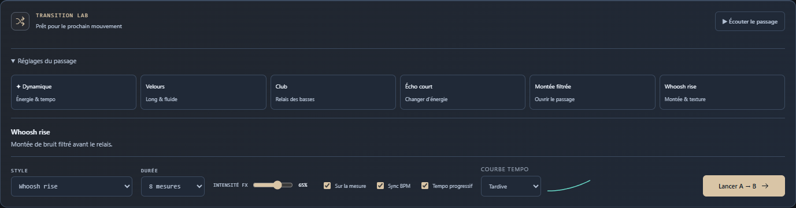

# Sillora DJ 0.30.0 — courbes de tempo musicales

Le tempo progressif possède quatre courbes réelles : **Souple, Linéaire, Anticipée et Tardive**. Souple devient le choix initial de l’interface. La durée et les repères suivent la courbe choisie ; les deux platines conservent un tempo commun avant le retour à la vitesse naturelle du titre entrant.

## Comportement livré

- Sélection persistante PC/Remote, aperçu de la progression et désactivation lorsque Sync ou Tempo progressif est coupé.
- Changer la courbe pendant un passage prépare le suivant sans réécrire l’automation en cours.
- Audio, horloges, partition de volumes/EQ/filtres, relais des graves, avances des repères et divisions d’écho partagent les mêmes 128 segments et leur intégrale. Les marqueurs d’onde suivent la distance musicale parcourue.
- La Remote reçoit la courbe complète et sa phase courante. Elle ne prolonge plus une portion non linéaire comme une rampe linéaire restante.
- Next et les durées raccourcies près de la fin utilisent la même courbe. Les grilles incertaines, les grands écarts de tempo et les repères manuels conservent leurs protections.

[Utilisation et limites](TEMPO-CURVES-0.30.md).

## Vérifications

**375 tests unitaires**, **61 cas natifs source** et **27 cas rejoués depuis le paquet final** passent.

| Cas dans le paquet | Nombre |
| :--- | ---: |
| Commandes PC/Remote, sauvegarde, isolation du passage actif et impulsions PCM | 11 |
| Deux MP3, quatre courbes Whoosh dans les deux sens, Auto et Next | 12 |
| Continuité du programme | 4 |

Les sources ajoutent douze rendus sur deux Opus du dossier Pop, douze cas d’espaces et dix scénarios de gestes. Le code embarqué est comparé aux sources. Les deux paires musicales possèdent des grilles calculées et non forcées manuellement. Les contrôles de rendu vérifient données finies, absence de saturation numérique et de fenêtre silencieuse de 50 ms pendant les passages, synchronisation des horloges et poursuite du titre entrant à sa vitesse naturelle.

Un banc d’impulsions PCM, sans maintien de hauteur, vérifie les événements audio réellement rendus : écart maximal **0.143 ms** entre les attaques et les instants attendus pour les quatre courbes. Cette mesure ne représente pas la latence du maintien de hauteur ni une mesure acoustique. [Résultats détaillés](TEMPO-MEASURES-0.30.json).

## Observations et limites

Le banc a révélé une réactivation du sélecteur Remote par la routine générale des contrôles alors que Sync était coupée : corrigée puis rejouée. Une capture offscreen a retourné UnknownVizError ; le banc réessaie cette capture au plus trois fois sans relâcher les contrôles audio ou de géométrie. Le premier aperçu capturait les réglages repliés ; la recette ouvre maintenant le panneau avant les mesures et la capture.

Ces essais portent sur quatre titres. Ils ne certifient pas la qualité perceptive de toutes les paires, la reconnaissance des phrases ou les longues sessions. Le maintien de hauteur conserve ses limites de timbre et sa latence ; les profils audio existants ne sont pas modifiés. Relecture par l’auteur, sans revue indépendante.

## Distribution

164 sources applicatives comparées au paquet, ressources et métadonnées contrôlées. Installateur et portable contiennent le même paquet ; intégrité de 7215 fichiers vérifiée. L’installateur n’est pas exécuté sur le profil personnel.

| Fichier | Octets | SHA-256 |
| :--- | ---: | :--- |
| Sillora-DJ-Setup-0.30.0.exe | 360416367 | f1521a7091e8ed46fc635f79308f1274c8343648289b099f4266751fb047a26c |
| Sillora-DJ-0.30.0-Windows.exe | 360174331 | 7ceb442fcf2bae80b378cc24faf159d74c2b95a45159abc2417185e63efcd0d3 |

[Suivi de l’audit](AUDIT-SUIVI.md) · [Projet](../README.md)
