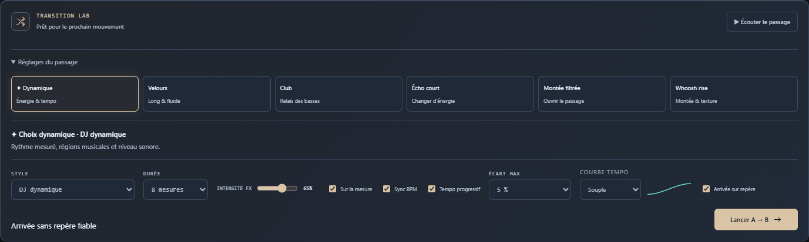

# Sillora DJ 0.31.0 — limites de tempo et propositions cohérentes

**Écart max** règle le plafond de tempo partagé par le moteur, les propositions du dossier et le tri Compatible. Six choix de 3 à 20 %, mémorisés et pilotables sur Remote. Les propositions prennent le BPM réel de la platine ; une modification de vitesse ne change pas le BPM natif du catalogue.

## Comportement livré

- Même mesure d’écart dans les deux directions, mêmes limites et mêmes contrôles de confiance pour les propositions et le passage.
- En mode compatible, priorité aux beatmatches réalisables puis aux grilles fiables ; clé, énergie et score de tempo départagent la même catégorie.
- Les cartes indiquent Beatmatch ou Tempo naturel avec une explication. Le score de classement n’est plus présenté comme un pourcentage de qualité musicale.
- Auto musical évalue les équivalences de pulsation ×½/×2 dans la limite choisie. Les styles explicites conservent la grille native.
- Un candidat hors limite reste jouable au tempo naturel. Le choix Ordre/Aléatoire, la file déjà préparée et le passage engagé restent conservés.
- Sélecteurs PC/Remote désactivés lorsque Sync est coupée ; préférences restaurées et propositions recalculées lors d’une modification.

[Fonctionnement et plafonds](TEMPO-POLICY-0.31.md).

## Vérification

**383 tests unitaires**, **32 scénarios natifs ciblés sur les sources** et **20 rejoués depuis le paquet final** passent.

| Périmètre | Source | Paquet |
| :--- | ---: | ---: |
| Commandes PC/Remote, suggestions, BPM réel, repli et sauvegarde | 10 | 10 |
| Pulsations après maintien de hauteur, trois courbes, deux sens et deux profils | 12 | — |
| Deux MP3, plafonds 5/20 %, deux sens et Next autorisé | 6 | 6 |
| Continuité du programme | 4 | 4 |

Les six rendus musicaux utilisent les grilles calculées des deux MP3, sans correction forcée. À 5 %, cette paire reste au tempo naturel ; à 20 %, le morphing est autorisé, y compris avec Next. Les rendus vérifient données finies, absence de saturation et de fenêtre silencieuse de 50 ms durant le passage, puis poursuite du titre entrant à sa vitesse naturelle.

Les essais de classement créent des métadonnées contrôlées à partir de deux tampons réels : ils ne sont pas une nouvelle collection de morceaux distincts. Ils vérifient aussi que le BPM lu sur la platine commande les propositions sans modifier le catalogue.

### Phase réellement rendue

Pulsations stéréo isolées, prises après maintien de hauteur et avant EQ, à 44,1 kHz. Le banc mesure les échantillons rendus par corrélation et par différence d’attaque, avec une résolution de 1 ms. Il ne compare pas uniquement les positions logicielles.

| Profil | Cas | Corrélation, écart maximal | Attaques, écart maximal |
| :--- | ---: | ---: | ---: |
| Standard | 6 | 13 ms | 14 ms |
| Rythme | 6 | 7 ms | 7 ms |

Les seuils de recette existants restent 16 ms Standard et 8 ms Rythme. Les observations ci-dessus ne sont pas des garanties sur toutes les musiques. Les latences de traitement restent environ 131 ms et 59 ms ; le DSP de maintien de hauteur n’est pas modifié. [Mesures](TEMPO-POLICY-MEASURES-0.31.json).

## Correction visuelle et limites

Une règle historique donnait au nouveau select une largeur minimale supérieure à celle de son label. La largeur est corrigée, et la recette contrôle désormais son débordement dans le panneau. Les 383 tests et dix contrôles natifs d’interface sont rejoués après cette correction. Seule la feuille tempo-control.css diffère du premier instantané de rendu : tous les autres fichiers du runtime, dont DSP et politiques de tempo/sélection, ont leurs empreintes identiques. Les rendus du paquet final utilisent la feuille corrigée.

Un premier rendu du paquet a révélé une course du banc au dernier point : la minuterie de transport pouvait remettre la source à zéro avant la sonde finale. Les rendus offline contrôlent maintenant explicitement leur tick terminal, déjà prévu par la recette ; les mêmes seuils de phase et d’audio sont conservés, puis les six passages sont rejoués. Ce défaut du banc n’est pas présenté comme une correction du DSP.

La reconnaissance des phrases, le jugement perceptif et les longues sessions restent ouverts. Un titre déjà préparé n’est pas remplacé automatiquement lorsqu’on resserre le plafond ; son passage peut alors se faire au tempo naturel. Relecture par l’auteur, sans revue indépendante ni installation dans le profil personnel.

## Distribution

165 sources applicatives comparées au paquet, ressources et métadonnées contrôlées. Installateur et portable contiennent le même paquet ; intégrité de 7215 fichiers vérifiée.

| Fichier | Octets | SHA-256 |
| :--- | ---: | :--- |
| Sillora-DJ-Setup-0.31.0.exe | 360417665 | 3c632a81d492ee248a99f6113b954b56b89a7efc88287c2f5ea0454bbc04d2fe |
| Sillora-DJ-0.31.0-Windows.exe | 360175670 | e5208fdd81aab6e53d17d796e580b8488da0d2d6c89b4a72502ad48c14f44932 |

[Audit](AUDIT-SUIVI.md) · [Projet](../README.md)
