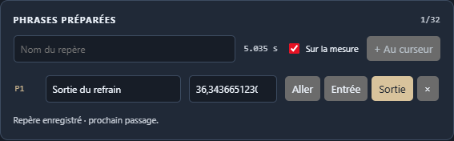

# Sillora DJ 0.32.0 — repères de phrase et relais préparés

**Phrases préparées** ajoute des annotations nommées, visibles sur les ondes et éditables PC/Remote. Un point d’entrée et un point de sortie peuvent guider le relais d’Auto musical, accessible par DJ dynamique avec le profil Mix musical. L’avance du titre entrant suit la partition, les courbes de tempo et la durée réelle de Next.

## Comportement livré

- Jusqu’à 32 points, nom/temps éditables, création au curseur, calage explicite à la mesure, navigation, rôle Entrée/Sortie et suppression.
- Commandes réelles dans Analyse et Outils DJ de Remote ; marqueurs P1/P2 sur les ondes. Les points mesurés R1/R2 restent distincts.
- Source préparée visée au relais et cible préparée atteinte par une avance recalculée. Next conserve l’arrivée cible quand elle est utilisable ; sa sortie immédiate reste prioritaire.
- Choix Auto limité aux partitions qui prennent en charge ces repères. Les styles explicites, autres profils, IN/OUT manuels et commandes de transport conservent leurs priorités.
- Sauvegarde dans la préparation, protection contre piste/révision obsolète et réemploi après analyse/rechargement. Une modification n’altère pas le passage déjà programmé.
- Identifiants utilisables sur HTTP local sans UUID sécurisé. Noms traités comme texte et positions vides rejetées sans déplacer un repère à zéro.

[Utilisation, réserves audio et priorités](PHRASE-CUES-0.32.md).

## Vérification

**393 tests unitaires**, **25 scénarios natifs source** et **19 depuis le paquet final** passent.

| Périmètre | Source | Paquet |
| :--- | ---: | ---: |
| Préparation PC/Remote, onde, édition pendant un passage, deux thèmes et rechargement | 9 | 9 |
| Deux MP3, repères activés/désactivés, deux sens et Next | 6 | 6 |
| Deux Opus du dossier Pop, même matrice | 6 | — |
| Continuité du programme | 4 | 4 |

Les grilles musicales sont calculées sans correction forcée. La recette place explicitement ses points sur des mesures connues pour vérifier le transport : ce ne sont pas des annotations musicologiques issues d’une écoute. Dans les rendus préparés, la sonde d’arrivée rejoint le point cible à moins de 10 ms ; le relais source planifié rejoint son point à moins de 0,01 ms, hors Next. Les horloges et les échantillons rendus sont contrôlés séparément : aucune donnée non finie, saturation ni fenêtre silencieuse de 50 ms pendant le passage. [Mesures détaillées](PHRASE-CUES-MEASURES-0.32.json).

La recette d’interface vérifie notamment l’identité de la source audio pendant les modifications, l’édition distante sans UUID sécurisé, l’étiquette P1 sur le vrai canvas Remote, le maintien de l’arrivée déjà programmée, deux thèmes aux largeurs 1440/480 et la récupération des points avec l’audio après rechargement. Le nom visible dans la capture est une annotation de recette.

## Relecture et limites

La relecture a trouvé un périmètre trop large : les sorties préparées pouvaient aussi déplacer des styles explicites. Elles sont désormais limitées à Auto musical, avec régression dédiée ; les contrôles du runtime final ont été recommencés après cette correction. Une position vide est refusée, et la création distante dispose d’un identifiant de repli pour HTTP local. La recette préliminaire interrompue n’est pas comptée comme une validation finale.

Il n’y a pas de reconnaissance automatique des phrases ou des voix. Le jugement musical, le jeu d’annotations humaines, les longues sessions et les autres sections de refonte restent ouverts. Les points hors mesure, sans réserve suffisante ou déjà dépassés peuvent être écartés sans modifier l’annotation enregistrée. Relecture par l’auteur ; installation personnelle non exécutée.

## Distribution

168 sources applicatives, ressources et métadonnées vérifiées. Installateur et portable contiennent le même paquet ; intégrité de 7215 fichiers contrôlée.

| Fichier | Octets | SHA-256 |
| :--- | ---: | :--- |
| Sillora-DJ-Setup-0.32.0.exe | 360421921 | ca56fd05cb06a2b0786cf4a042f837e8377ff329fb7d50a433f89cee25f21030 |
| Sillora-DJ-0.32.0-Windows.exe | 360179945 | d16fbff9ba11e32d9434f05110fb870f7a66c4a322f3ba5b71e8aff496e9dddb |

[Audit](AUDIT-SUIVI.md) · [Projet](../README.md)
