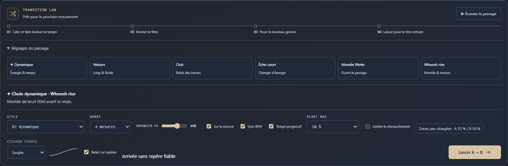

# Sillora DJ 0.33.0 — chevauchement mesuré et relais protégé

Le choix dynamique utilisait une mesure de densité prise au début et à la fin des titres, même lorsque le passage jouait ailleurs. La mesure porte désormais sur les fenêtres sélectionnées et est recalculée sur les points effectivement armés.

**Limiter le chevauchement**, disponible sur PC/Remote, raccourcit le mélange direct de deux zones chargées. Le relais, les repères et la durée restent identiques ; le filtre, le souffle et l’écho ajouté suivent l’intensité FX. La vitesse commune évolue progressivement et retrouve celle du titre entrant. [Utilisation et limites](OVERLAP-0.33.md).

## Vérification

| Périmètre | Source | Paquet |
| :--- | ---: | ---: |
| Option PC/Remote, sauvegarde, visibilité, passage actif, thèmes et tailles | 9 | 9 |
| Deux MP3, protection activée/désactivée, deux sens et Next | 6 | 6 |
| Deux Opus Pop, même matrice | 6 | — |
| Continuité du programme | 4 | 4 |

**404 tests unitaires passent.** Les grilles et régions des quatre titres sont calculées sans correction forcée. Les comparatifs complets vérifient l’identité des points, du relais et de la durée. Le passage MP3 chargé 98 → 110 passe de 16 à 2 temps de chevauchement ; Next utilise un temps. Les sondes contrôlent la phase et les échantillons, sans non-fini, saturation ou silence de 50 ms pendant les passages. [Mesures et comparatifs](OVERLAP-MEASURES-0.33.json).

Les tests contrôlent aussi les fenêtres pondérées, les données manquantes, les IN/OUT et phrases préparées, la mesure différente de Next, les courbes à puissance constante, FX zéro, la validation distante et la conservation des voix pendant une modification. L’option n’est pas un détecteur de voix et ne garantit pas un meilleur rendu sur chaque paire. La reconnaissance sémantique, l’annotation humaine, les longues sessions et la fin de la refonte restent ouvertes. Relecture par l’auteur ; profil personnel et installation existante non modifiés.

## Distribution

169 sources applicatives comparées au paquet final. Ressources embarquées, version et copyright contrôlés ; installateur et portable contiennent le même paquet, avec intégrité de 7215 fichiers vérifiée.

| Fichier | Octets | SHA-256 |
| :--- | ---: | :--- |
| Sillora-DJ-Setup-0.33.0.exe | 360424701 | c5539fc47e39f5df53b3468f1ff3a74ef7c374658b3ab06d23bc6624304ee0fa |
| Sillora-DJ-0.33.0-Windows.exe | 360182699 | 7368e571952383fad590322cc68391e45966288f063072c08c635517bf7d0f31 |

Les binaires sont préparés localement et ne sont pas publiés dans GitHub Releases. [Audit](AUDIT-SUIVI.md) · [Projet](../README.md).
