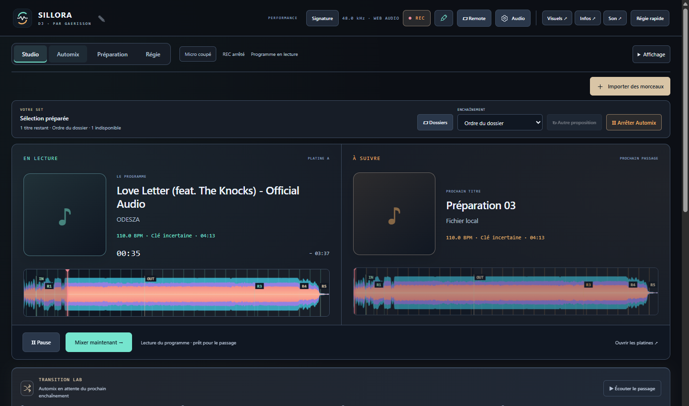

# Sillora DJ 0.34.0 — prochain titre et continuité du set

Un prochain fichier absent ou illisible pouvait arrêter Automix alors que d’autres morceaux étaient disponibles. Le studio l’écarte désormais du set en cours, prépare un autre choix et conserve la source audible. Les commandes de préparation appartiennent à leur set et à leurs platines ; une fin tardive ne peut plus reprendre leur contrôle.

- Repli après une lecture refusée, exclusions temporaires et propositions PC/Remote cohérentes.
- Réservation mémoire par identité avant le décodage, jusqu’à l’affectation ; plusieurs consommateurs libèrent leurs réservations indépendamment.
- Priorité et attente d’une analyse déjà demandée, état de préparation visible et protection des erreurs obsolètes après arrêt/reprise.
- Fin normale du set malgré un import indépendant ; maintien de secours réservé à une préparation utile.

[Utilisation et limites](NEXT-PREPARATION-0.34.md).

## Vérification

**416 tests unitaires passent.**

| Périmètre | Source | Paquet |
| :--- | ---: | ---: |
| Préparation PC/Remote, faute native, mémoire, annulation, EOF et sept enchaînements | 9 | 9 |
| Deux MP3, Whoosh et Auto dans les deux sens, grilles calculées | 4 | 4 |
| Deux Opus Pop, Auto dans les deux sens | 2 | — |
| Continuité du programme | 4 | 4 |

La chaîne utilise huit références partageant les buffers de deux fichiers, avec IN/OUT courts explicitement placés pour accélérer la recette. Elle vérifie l’alternance et la propriété des platines, pas un set de huit titres distincts ni un usage de plusieurs heures. Les six rendus séparés, sur quatre vrais fichiers, n’ont ni échantillon non fini, ni saturation, ni fenêtre silencieuse de 50 ms pendant les passages ; la phase et le tempo sont contrôlés. Aucun nouvel effet DSP ni gain de qualité perceptive n’est revendiqué. [Mesures détaillées](NEXT-PREPARATION-MEASURES-0.34.json).

La relecture a ajouté la protection de génération dans le chemin d’erreur et l’exclusion des propositions distantes. Les recettes finales utilisent le runtime terminé. Les erreurs de fichiers testées sont injectées dans le service natif de lecture ; elles ne suppriment ni ne modifient les musiques originales. Relecture par l’auteur, profil personnel inchangé.

## Distribution

170 sources applicatives identiques au paquet, ressources et métadonnées contrôlées. Le portable et l’installateur contiennent le même paquet ; intégrité de 7215 fichiers vérifiée.

| Fichier | Octets | SHA-256 |
| :--- | ---: | :--- |
| Sillora-DJ-Setup-0.34.0.exe | 360426552 | 03281e9c8459401e290be73d536ca832ff3684c96360e7e97a76aaf797721ab0 |
| Sillora-DJ-0.34.0-Windows.exe | 360184560 | 6b3262cd1b3f79557e074eb6e7268c2488591bf189580951d3deb07fe3252848 |

Binaires préparés localement, hors GitHub Releases. La préparation automatique des stems, les sessions longues, la validation acoustique et les autres points de refonte restent ouverts. [Audit](AUDIT-SUIVI.md) · [Projet](../README.md).
