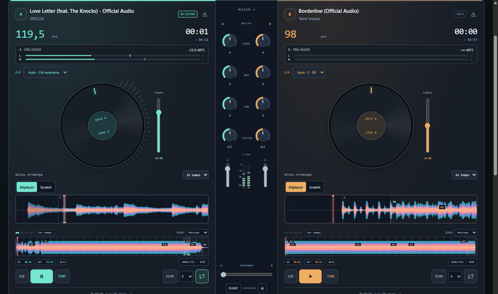

# Sillora DJ 0.35.0 — raccords de boucle et retour du Roll

Les boucles ordinaires répétaient leurs limites sans traitement de raccord. Le Slip Roll calculait aussi son retour avec la vitesse de départ, puis redémarrait le traitement de hauteur. Le moteur ajoute des microfondus sur l’horloge audio, suit les vitesses réellement programmées et garde l’ancien flux pendant l’amorçage du retour.

Les tailles **¼ à 32 temps** sont communes au PC et à Remote. La boucle active peut être redimensionnée sans changer de source ; son origine est conservée et une réduction peut recaler la tête au début. La taille affichée suit celle du moteur. [Utilisation](LOOPS-0.35.md).

## Vérification

**431 tests unitaires passent.**

| Périmètre | Source | Paquet |
| :--- | ---: | ---: |
| PC/Remote, fractions, redimensionnement, Roll, vitesse, thèmes et tailles | 7 | 7 |
| Raccords synthétiques, deux fréquences, vitesses et huit canaux | 10 | 10 |
| Deux fichiers musicaux, profils de hauteur, Roll et fixture stems | 5 | 5 |
| Whoosh et Auto sur deux MP3, deux sens | 4 | 4 |
| Auto sur deux Opus Pop, deux sens | 2 | — |
| Continuité du programme | 4 | 4 |

Les dix bancs de raccord mesurent un saut maximal de 0.900 avant traitement et 0.000266 après traitement. Les cinq rendus musicaux ne présentent ni échantillon non fini, ni saturation, ni fenêtre de 50 ms sous RMS 0,0001 autour du relâchement. Le signal avant activation de la boucle reste identique entre les deux chemins à moins de 0,000001.

Le comparatif avec le paquet 0.34 emploie les mêmes quatre premières recettes. Sur les deux Roll testés, l’ancien transport avait environ une seconde d’écart et des fenêtres de 50 ms très faibles. La 0.35 rejoint l’horloge attendue et garde ces fenêtres au-dessus du seuil. Le banc musical isole la voix et son maintien de hauteur ; les rendus de transition et de continuité contrôlent le programme séparément. [Données complètes](LOOP-MEASURES-0.35.json).

Les tests unitaires couvrent aussi l’expansion après plusieurs tours, pause/reprise, le retour au-delà d’EOF et l’annulation pendant l’amorçage. Les commandes distantes sont validées et la recette attend l’état reçu du PC. L’essai à 480 px du rendu PC a été remplacé par la largeur Windows minimale prise en charge, 1080 px ; le client Remote est testé à 390 px.

La réduction des discontinuités mesurées ne certifie pas le timbre sur toute une collection. Les longues sessions, le calage musical général et les autres sections de refonte restent ouverts. Relecture par l’auteur ; les musiques et le profil personnel ne sont pas modifiés.

## Distribution

174 sources applicatives comparées au paquet final, ressources et métadonnées contrôlées. Installateur et portable contiennent le même paquet, avec intégrité de 7215 fichiers vérifiée.

| Fichier | Octets | SHA-256 |
| :--- | ---: | :--- |
| Sillora-DJ-Setup-0.35.0.exe | 360429453 | 07a4f38a0de034045f1e203adfe19b261bf796adbd56764c630059e1a16b99d4 |
| Sillora-DJ-0.35.0-Windows.exe | 360187475 | 44b5be54d3fb86cedba4b272eb92cd2907caab986780cbdeff708f9163ae8a53 |

Binaires préparés localement, hors GitHub Releases. [Audit](AUDIT-SUIVI.md) · [Projet](../README.md).
