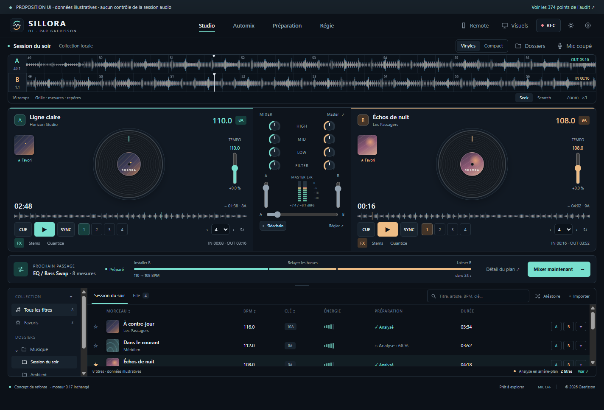
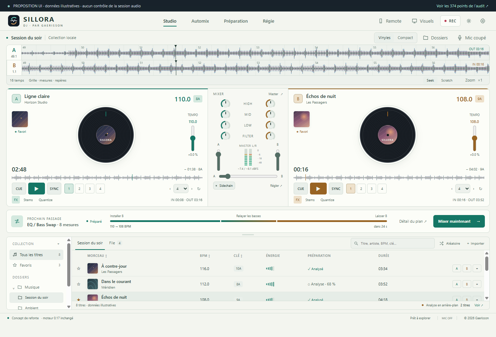
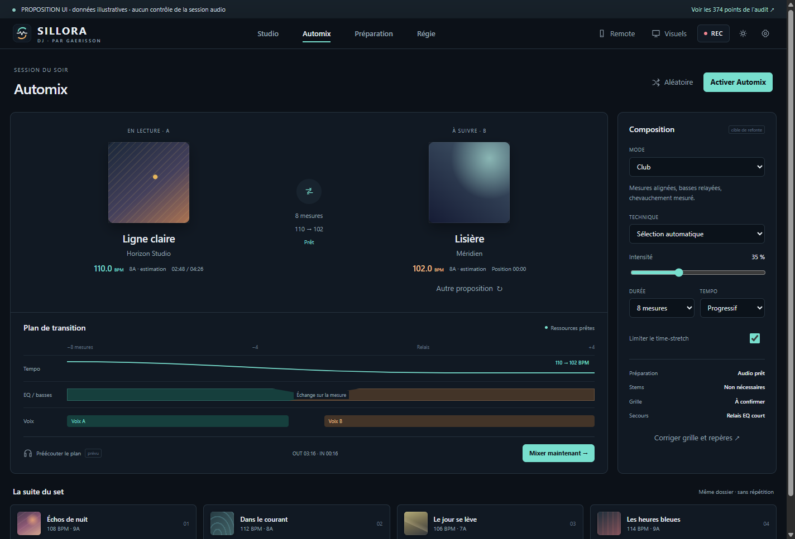
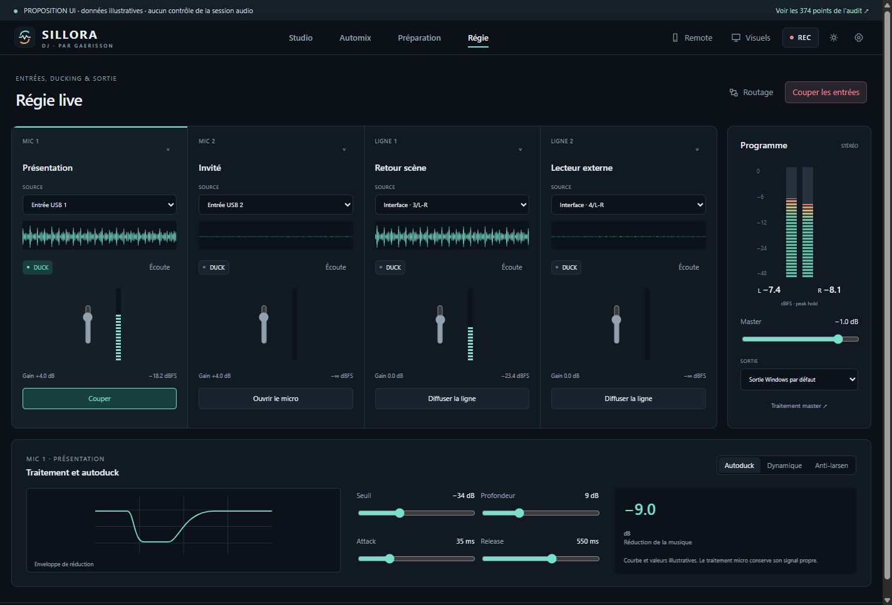

# Sillora DJ — proposition de refonte du produit et de l’interface

État examiné : 0.17.0. Proposition du 28 octobre 2026.

La refonte ne consiste pas à changer les couleurs des commandes existantes. Elle organise le transport, le plan de transition, la préparation des titres et la régie autour d’un état commun. Le moteur audio reste prioritaire sur la présentation.

Cette livraison contient un **audit du projet et une maquette navigable**. La maquette fonctionne avec des données illustratives, ne produit aucun son, n’ouvre aucun micro et ne pilote pas la version installée. Ses commandes nouvelles sont une proposition, pas une déclaration de fonctionnalités terminées.

- [Registre des 374 points examinés](AUDIT-REFONTE.md)
- [Sources de la maquette](../design/refonte/index.html)
- [Suivi de réalisation](../PROGRESS.md)

La maquette s'ouvre directement dans un navigateur. Un aperçu HTTP local peut être démarré par `node design/refonte/serve.mjs` ; il ne lance pas le moteur DJ.

## Aperçus de la proposition

Ces captures proviennent de la maquette, avec des titres, courbes et niveaux illustratifs. Elles se distinguent des captures de la version actuelle dans la galerie principale.

### Studio · Obsidienne

### Studio · Porcelaine

### Automix

### Régie

## Ce que l’audit change dans l’approche

| Constat sur le projet actuel | Conséquence pour la refonte |
|---|---|
| Le sélecteur utilise des estimations de tempo/tonalité et des fenêtres d’énergie. Il ne détecte pas de vraies phrases, voix ou drops. | Ne pas nommer « Build & Drop » un simple souffle. Ajouter les analyses et repères manuels avant de proposer le mode. |
| Un relais peut être préparé avant OUT, mais la reprise d’un titre après EOF ne garantit pas l’absence de silence si le prochain titre manque. | Le plan doit avoir une échéance de préparation et un secours armé avant l’épuisement du signal. |
| Les deux barres du VU master utilisent la même amplitude. | Ajouter un tap stéréo réel après le traitement programme, des mesures par platine, puis relier les mètres à ces mesures. |
| Le scratch vinyle est audio ; l’onde fait uniquement des seeks. | Deux gestes explicites, Seek / Scratch, avec réglages distincts. Ne pas rebaptiser le seek « scratch ». |
| L’import reste progressif au décodage, l’analyse ne dispose que d’une priorité partielle et l’encodage WAV des stems peut monopoliser l’interface. | Distinguer découverte, décodage, analyse et séparation. Afficher les titres immédiatement et déplacer les préparations lourdes dans des workers/services. |
| Le studio accumule des couches CSS historiques et monte beaucoup de DOM depuis un module central. Remote possède une autre présentation. | Créer des composants et des tokens stables, puis partager état, intentions et composants entre le studio et Remote. |
| Les sources acceptent des liens unitaires, avec `--no-playlist` / `--no-continue`. Aucun système d’updates applicatif n’est installé. | Traiter playlists, file persistante et updates comme des développements complets, avec migration et récupération. |

La séparation actuelle est limitée à huit minutes/160 Mo d'entrée, avec un seul travail actif. Le script prévoit CUDA lorsque le matériel et le runtime le supportent, mais la distribution préparée est CPU. La reconstruction mémoire PCM, les coûts d'encodage et le maintien de hauteur doivent être mesurés sur la machine cible. Une latence réseau d'état ne démontre pas une réaction sonore instantanée.

## Direction visuelle retenue

Une console sobre et précise : **Obsidienne** et **Porcelaine**, accents menthe pour A et ambre pour B, surfaces mates et relief limité. La couleur identifie un canal, une source ou un état utile. Les vues évitent les slogans, les scores musicaux invérifiables et les effets lumineux qui masquent les commandes.

Le logo Sillora et la signature Gaerisson restent au même endroit. Nom et logo personnels sont accessibles dans Identité. Les crédits IA et licences figurent dans À propos, avec Gaerisson titulaire du copyright.

Les vinyles conservent un rapport 1:1, une rotation liée au transport et un décor indépendant. Leur affichage est optionnel : le mode compact favorise les ondes et la bibliothèque. Les effets de disque et les scènes de vidéoprojecteur ont des réglages séparés.

## Architecture des écrans

### Studio — jouer en manuel

Ordre visuel : en-tête → ondes alignées → platines et mixer → prochain passage → bibliothèque.

- Deux ondes détaillées sur toute la largeur. Repères de mesures, premier temps, cues, IN/OUT et zone de passage lisibles.
- Boutons Seek / Scratch visibles pour lever l’ambiguïté du geste. Zoom local et aperçu global du morceau séparés.
- Deux platines avec pochette, titre, BPM, clé, temps, vinyle, pitch, transport, cues et boucle. Les réglages rares passent dans l’inspecteur.
- Mixer central avec EQ/filtre, gains, faders, crossfader et mesure master. Les niveaux de canal doivent être mesurés à leur emplacement réel dans la chaîne.
- Rail « Prochain passage » : technique, longueur, tempo, état de préparation, compte à rebours, détail et Mixer maintenant.
- Bibliothèque directement accessible, dossiers espacés, favoris, pochettes, tri et états d’analyse. Sa hauteur se règle à la souris ou au clavier.
- Micro coupé/ouvert et enregistrement restent visibles même lorsque les panneaux correspondants sont repliés.

### Automix — comprendre et préparer le relais

Deux cartes simples : morceau courant et morceau suivant. Au centre, le relais prévu et son état. Sous les cartes, une timeline du **plan réellement exécuté** : tempo, échange des basses, voix, effets et relais final.

L’inspecteur porte mode, technique, durée, intensité, courbe de tempo, limites et politique de secours. Les six modes demandés ne doivent pas être six libellés sur le même moteur : chacun doit avoir une politique d’admissibilité et des résultats distincts.

États à afficher : prochain titre absent, décodage, analyse, stems utiles en préparation, prêt, armé, en cours, annulé, secours. Un plan qui n’a pas ses ressources doit rester signalé comme tel. « Préparé » ne veut pas dire que toutes les analyses sont terminées, mais que les ressources nécessaires à **ce plan** le sont.

Mixer maintenant utilise une frontière proche et musicalement admissible. La répétition du plan sur le master et une future préécoute isolée ne doivent pas être confondues. La sortie casque séparée n’existe pas encore en 0.17.

### Préparation — travailler pendant que la musique continue

- Liste de tâches avec lecture/prochain titre en priorité, puis file du set, sélection, dossier et fond de bibliothèque.
- Découverte immédiate des fichiers ; accès à la lecture dès le minimum nécessaire. Les analyses ne verrouillent pas les commandes de lecture.
- États séparés pour audio disponible, grille estimée/corrigée, analyse approfondie et stems en cache.
- Éditeur BPM, premier temps, grille et régions. Les sections sémantiques incertaines restent à confirmer, sans inventer un drop ou une voix.
- Réanalyse, pause/annulation et reprise. Ancienne analyse conservée tant que le remplacement n’est pas validé.
- Contrôles Batterie / Basse / Instruments / Voix avec niveau, mute et solo, état de préparation et repli disponible.

### Régie — gérer la sono

Quatre entrées micro/ligne et un programme stéréo. Le panneau rapide reste replié par défaut dans Studio ; l’espace Régie permet de travailler en détail.

- Sélecteur de source, forme d’onde réelle, gain, niveau pré/post traitement, monitoring, armement et diffusion clairement séparés.
- Pour l’entrée sélectionnée : onglets Autoduck, Dynamique et Anti-larsen. Courbe, seuils et réduction visibles à côté des sliders.
- L’autoduck micro réduit la musique et laisse le micro sur son propre chemin. Le pompage musical reste un outil distinct.
- Entrées actives toujours identifiables. Une commande explicite coupe les entrées ; le PANIC programme conserve sa propre portée, clairement nommée.
- Master : mesures L/R distinctes, RMS, peak, peak-hold, clipping et échelle dBFS. Aucun canal ne doit utiliser la copie graphique d’un autre.
- Routage lisible : entrées → traitement → programme → sortie/enregistrement. La perte d’un périphérique donne un état réel et une action de récupération.

L’anti-larsen automatique doit afficher sa détection et ses filtres, et laisser corriger leurs paramètres. Des tests synthétiques ne remplacent pas un essai dans une salle avec micro et haut-parleurs.

### Visuels — un espace de diffusion séparé

Aperçu, scène, palette, sensibilité, vitesse, détail, qualité et destination. Les paramètres sont propres à la scène, avec transition de scène progressive, résolution/FPS choisis et mode sans flashs.

Le pilotage futur utilise un flux musical horodaté : niveau, bandes, transitoires, beat/downbeat, structure validée et état de transition. Les modes 3D/fluides ne sont pas annoncés comme présents à partir des scènes Canvas 2D existantes.

La scène peut être désactivée ou sa fenêtre fermée sans affecter l’audio. Le média courant et le logo peuvent être affichés sur un second écran.

### Réglages et Sources

Un seul inspecteur pour Audio, Mix/tempo, Analyse, Gestes, Sidechain, Identité et Versions. Les contrôles concernent le contexte choisi, avec unités et valeurs visibles.

Sources propose un aperçu de playlist avant import, sélection des titres, progression par item, reprise et doublons. Seuls les services réellement utilisables sont proposés ; un catalogue d’abonnement indisponible ne devient pas une fausse connexion.

Versions affiche notes, intégrité/authenticité, téléchargement, état de session et récupération. Aucun installateur ne doit fermer une session DJ active automatiquement. La migration du dossier Musique est un travail de données, pas un remplacement de chaîne de caractères.

### Remote

Même modèle d’état, même vocabulaire et mêmes commandes que sur le PC. L’interface s’adapte à la largeur ; sur téléphone, programme/prochain titre, Mixer maintenant et état micro sont prioritaires, avec accès aux autres modules.

Les actions distinguent envoyé, accusé et appliqué ; les données signalent leur fraîcheur. Déconnexion et état périmé suspendent les commandes jusqu’à récupération. Le son reste sur le PC. Le réseau local HTTP actuel ne doit pas être présenté comme un transport chiffré.

## Socle de composants proposé

| Composant | État nécessaire | Réutilisation |
|---|---|---|
| `DeckPanel` / `TransportControls` | Position audio, taux, rampes, boucle, scratch, cues, état commandé/appliqué | Studio, Remote |
| `WaveformViewport` | Pics multi-résolution, bandes, grille, cues, plage visible, horloge commune | Studio, préparation, Remote |
| `TransitionTimeline` | Plan immuable et état des ressources, automations et secours | Studio, Automix, Remote |
| `LibraryTable` / `FolderTree` | Entrées découvertes, sélection, collection, favoris et tâches | Studio, préparation, Sources |
| `AudioMeter` | Points de mesure, RMS/peak L/R, hold, clipping et horodatage | Platines, master, régie, Remote |
| `InputChannelStrip` / `DynamicsEditor` | Source, monitoring, diffusion, traitement, ducking et mesure | Régie, fenêtre Son, Remote |
| `SettingsInspector` | Capacités réellement disponibles, état appliqué et préférences | Tous les espaces |
| `VisualSceneHost` | MusicalFrame, scène, cadence, destination et mode sûr | Aperçu, fenêtre externe |
| `TaskQueue` | Identifiant de contenu, priorité, étapes, annulation et reprise | Analyse, stems, imports |

Les composants visuels envoient des intentions ; ils ne possèdent pas une seconde horloge musicale. La migration peut rester en modules JavaScript dans Electron. Un changement de framework ou de moteur natif doit répondre à un besoin mesuré, sans multiplier les couches historiques de styles.

## Contrats indispensables avant le branchement UI

1. **Transport** : position et vitesse proviennent de l’audio, et non d’un compteur visuel. Une commande indique son échéance et son application réelle.
2. **TrackReadiness** : découverte, audio, analyse et stems sont des états indépendants. Une erreur d’analyse n’empêche pas de jouer l’original.
3. **TransitionPlan** : identifiant/révision, sources, repères, durée, horloge/tempo, automations, ressources, échéance et secours. L’interface affiche le même plan que l’exécuteur.
4. **AudioMetrics** : mesures réelles et emplacements de chaîne explicites. Une latence d’ACK réseau ne devient pas une mesure de latence acoustique.
5. **MusicalFrame** : événements validés, confiance et horodatage. Les scènes n’inventent pas une phrase à partir de la seule FFT.
6. **Capabilities** : montrer une fonction lorsqu’elle peut aboutir ; identifier les fonctions indisponibles et leur cause, sans boutons d’intégration factices.

## Migration sans régression

| Lot | Réalisation | Porte de validation |
|---|---|---|
| A · État et mesure | Contrats partagés, mesures réelles, diagnostics, secours avant EOF | Tests sous charge, perte/préparation tardive et session prolongée |
| B · Bibliothèque | Découverte immédiate, file prioritaire complète, reprise/cache/réanalyse | Grande collection, interruption et redémarrage pendant lecture |
| C · Plan musical | Analyse des phrases/repères, politiques des modes et techniques distinctes | Corpus annoté, rendu mesuré et comparaison d’écoute |
| D · Composants Studio/Automix | Nouveau shell, ondes, platines et timeline branchés au moteur | Parité de commandes, état et raccourcis avec la version précédente |
| E · Régie/Remote/Visuels | Composants partagés, routage, scènes, entrée/ducking et états distants | Matériel réel, salle, réseau instable et second écran |
| F · Produit | Sources, updates, migration, About et documentation | Paquet complet, données conservées et récupération après échec |

La maquette définit les emplacements et les interactions avant le branchement. Elle n’autorise pas à marquer les lots audio B/C/E comme terminés.

## Recette UI à conserver

- Studio sur écran large : bibliothèque, ondes et transport accessibles ; densité adaptée à la hauteur, mode compact volontaire et bibliothèque redimensionnable.
- En dessous de 940 px : contrôles réorganisés ; sur téléphone, navigation et actions essentielles restent utilisables sans débordement horizontal.
- Thèmes Obsidienne/Porcelaine, contrastes mesurés, zoom, focus clavier, gestes annulables et préférence de mouvement réduit.
- Couleur doublée par des libellés/états ; unités visibles ; champs éditables et données copiables conservent leur sélection de texte.
- Les gestes Seek, Scratch, boucle immédiate et boucle quantifiée ne doivent jamais déclencher un autre comportement par surprise.
- Chaque action critique a une portée explicite : pause platine, arrêter Automix, couper les entrées ou arrêter le programme.

## Ce qui est livré ici

Audit de 374 points, examen de l’architecture réelle, baseline de 213 tests réussis et proposition navigable couvrant Studio, Automix, Préparation, Régie, Visuels, Remote, Sources et réglages. Les données et niveaux de la maquette sont illustratifs. La version audio 0.17.0 est inchangée.
