# Sillora DJ en images

Les vues générales proviennent de la 0.16.1 exécutée ; les vues de préparation et de gestes sont datées ci-dessous. Les morceaux et pochettes illustrent une session locale ; aucun fichier musical n’est distribué avec le dépôt.

## Préparation des stems · 0.27.0

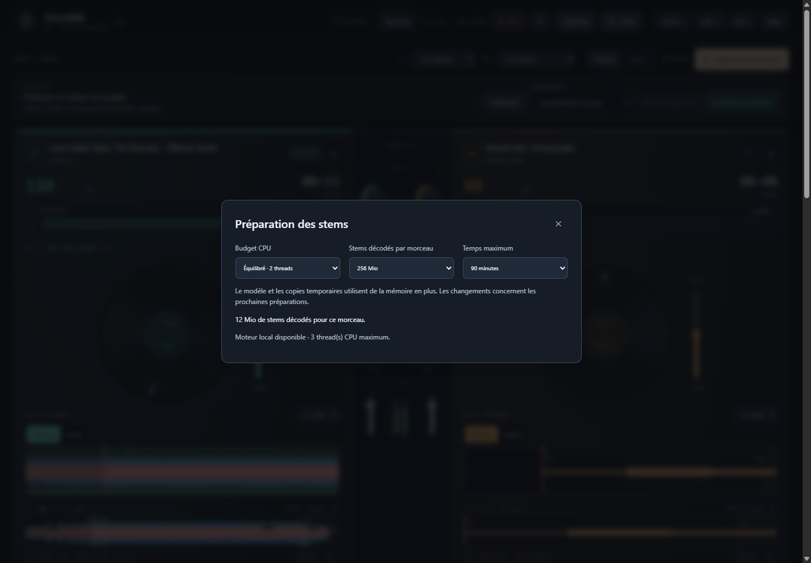

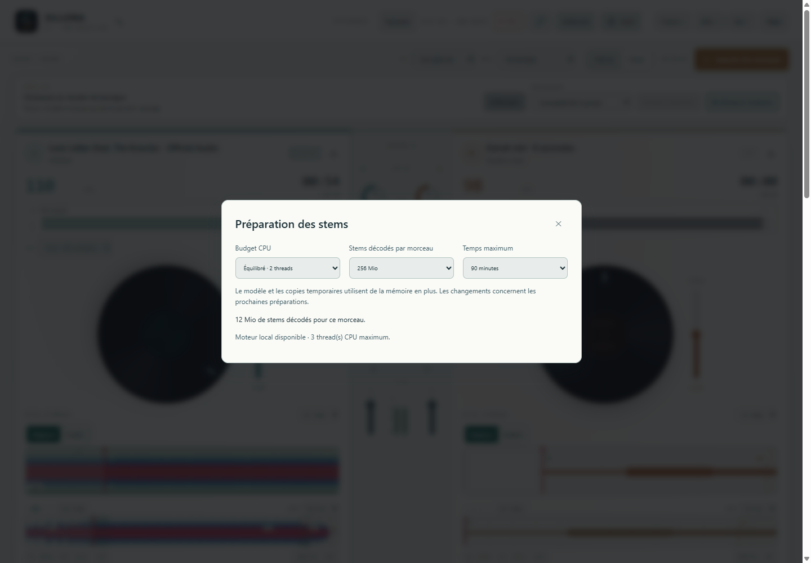

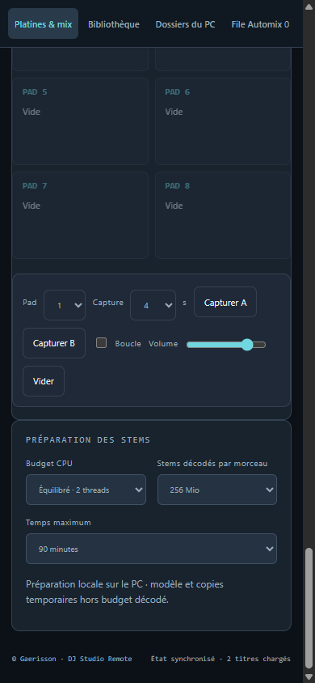

Réglages réels du paquet Windows et de Remote appairé. [Fonctionnement](STEMS-0.27.md).

## Arrivée au relais · 0.26.0

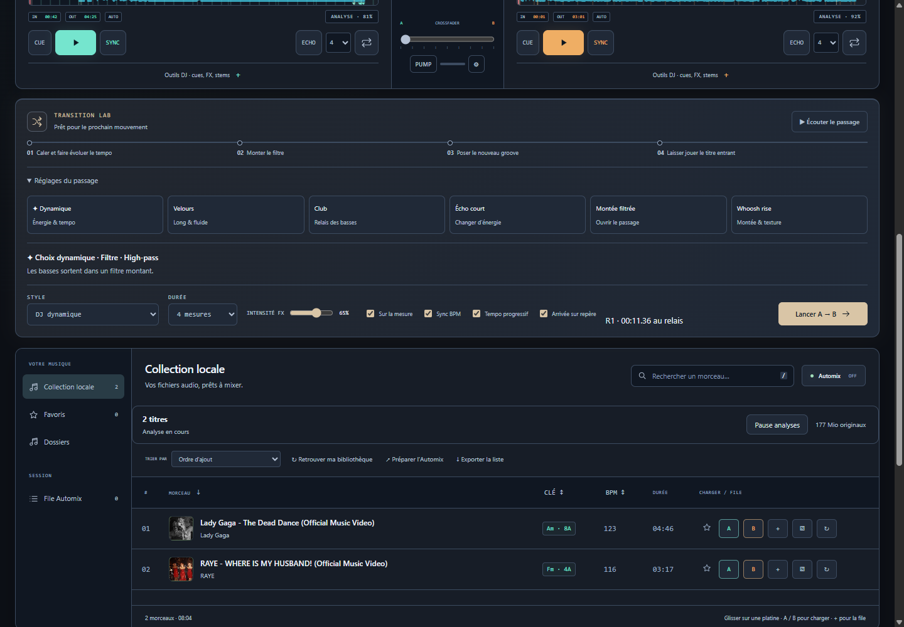

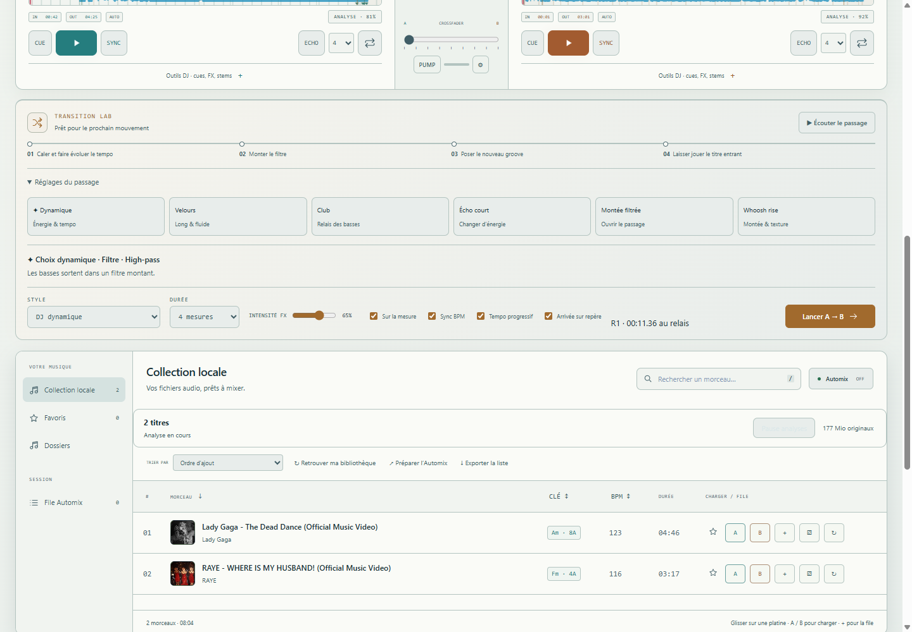

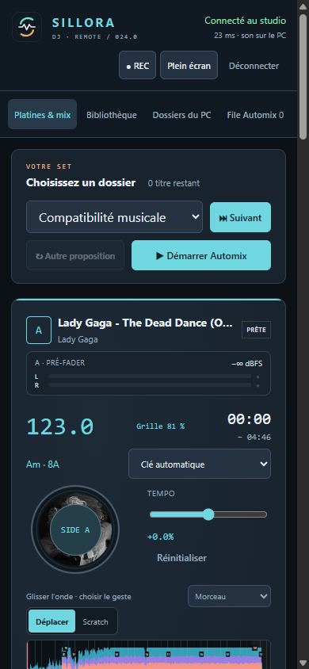

Captures du paquet avec deux Opus analysés automatiquement. Le repère mesure un changement de niveau ou de graves ; aucune phrase sémantique n’est reconnue. [Fonctionnement](ARRIVAL-0.26.md).

## Grille rythmique · 0.25.0

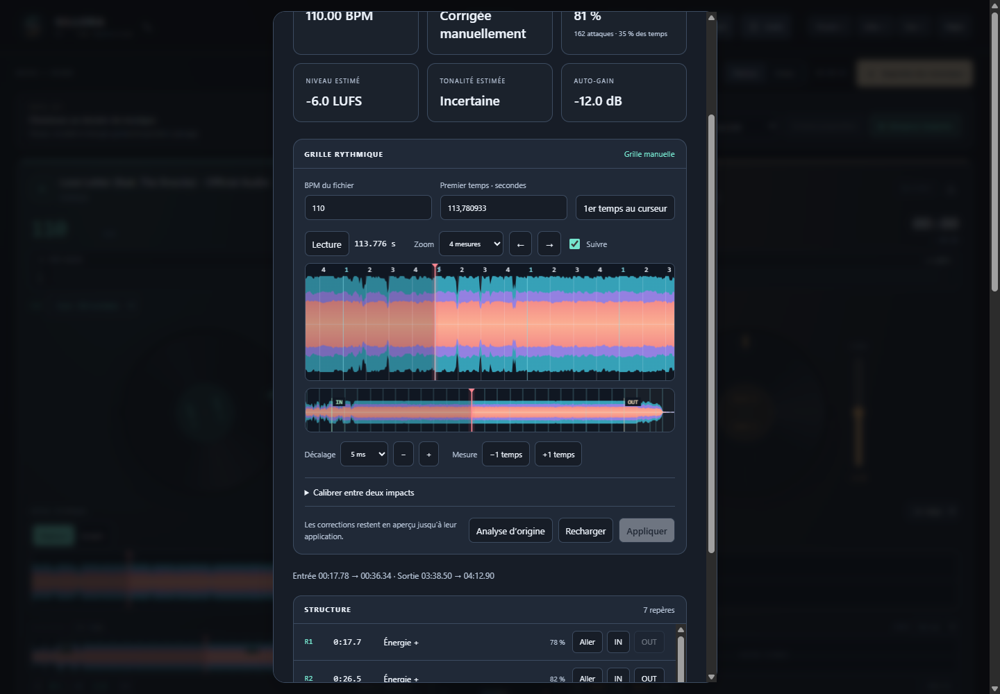

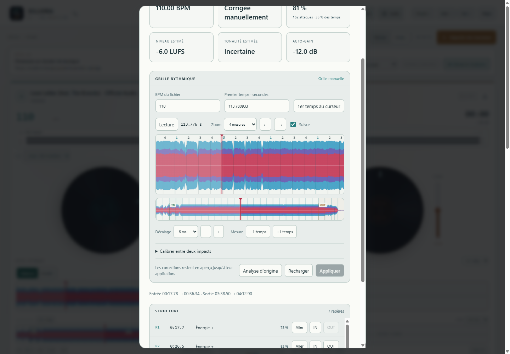

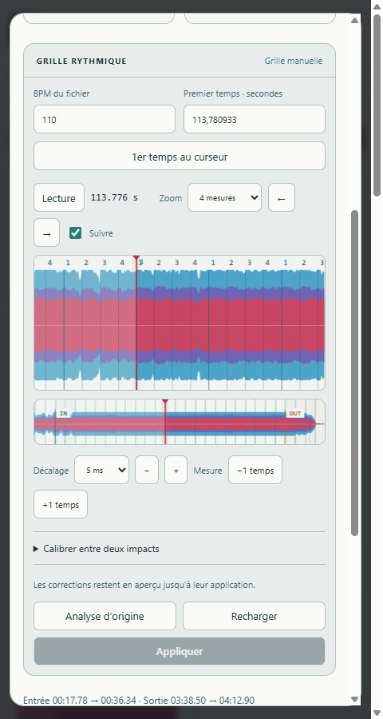

Captures du code embarqué avec un vrai fichier et une correction de grille explicite. Le banc vérifie le dessin après réouverture et la persistance ; ces positions ne sont pas une référence rythmique annotée. [Utilisation](PREPARATION-0.25.md).

## Gestes d’onde · 0.24.0

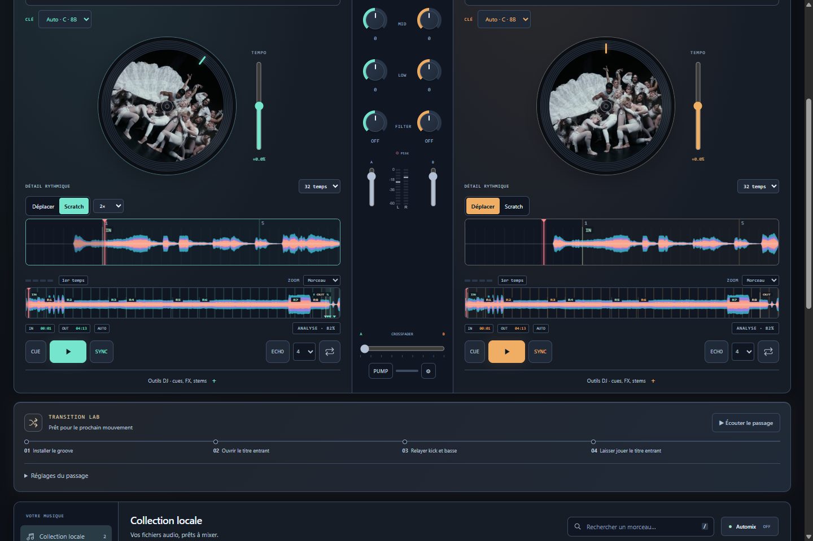

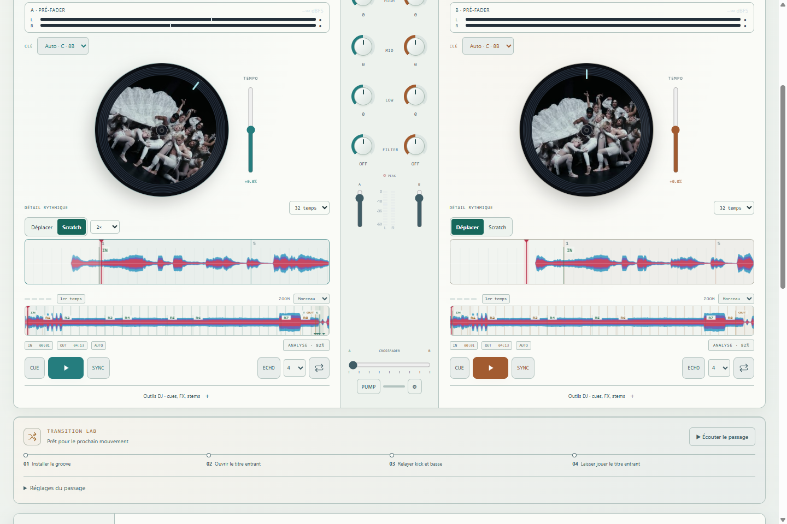

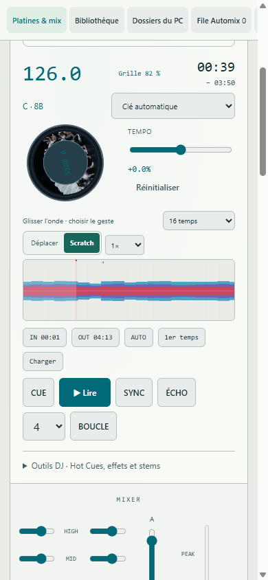

Le clic Scratch saisit la tête actuelle ; Déplacer conserve la navigation. La sensibilité de l’onde est mémorisée sans modifier le vinyle. Ces captures proviennent du code du paquet Windows avec des fichiers réels ; la refonte complète de la maquette reste distincte. [Fonctionnement et limites](GESTURES-0.24.md).

## Analyse automatique · 0.23.0

Capture depuis le code embarqué dans le paquet Windows : stabilité 81 %, 162 attaques couvrant 35 % des temps et cinq repères mesurés. Aucun réglage manuel de grille n’est injecté. Les scores sont des indices internes ; les repères ne reconnaissent pas encore les phrases musicales.

Remote reçoit le même indice de grille et les mêmes mesures. Le son reste sur le PC. [Fonctionnement et périmètre](GRID-0.23.md).

## Préparation · 0.22.0

Repères mesurés après correction explicite de la grille, navigation et pose de IN/OUT. La carte de ce titre nécessite encore cette correction ; elle n’est pas présentée comme une détection automatique de phrases.

## Studio

Deux titres chargés, pochettes sur les vinyles, onde globale, détail rythmique, mixer et entrées live.

## Porcelaine

## Automix

## Remote Web

[Retour au projet](../README.md)
