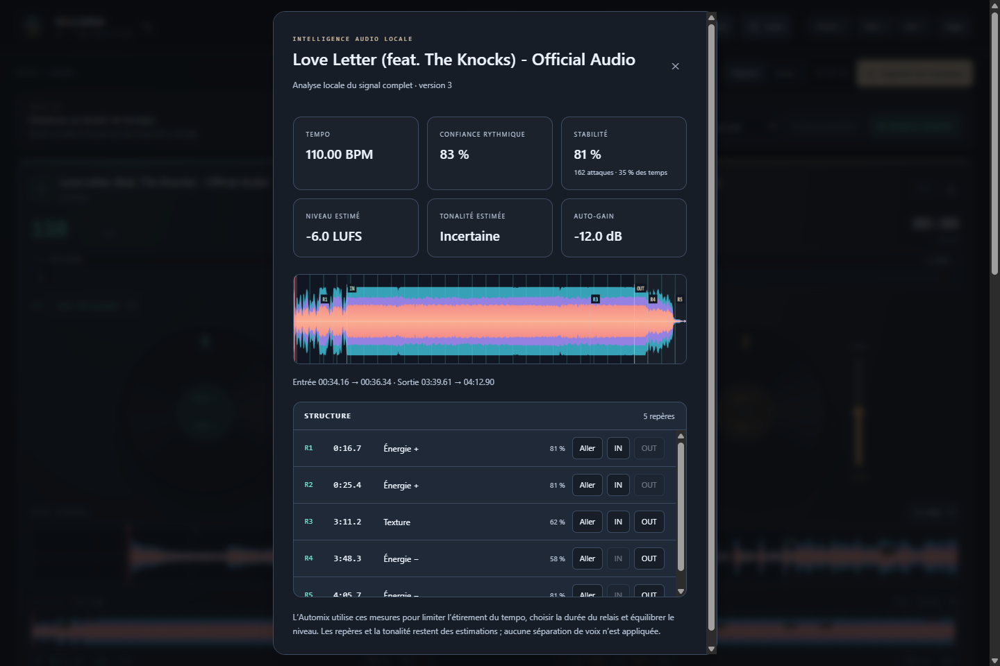
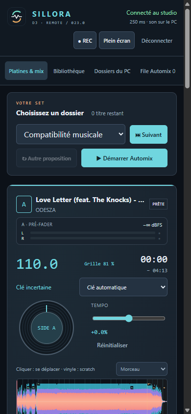
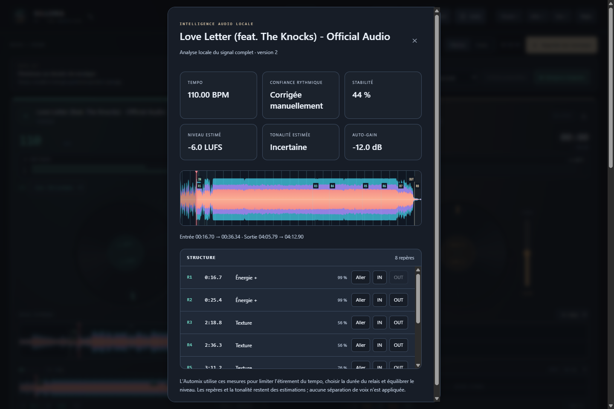

# Sillora DJ en images

Les vues générales proviennent de la 0.16.1 exécutée ; les vues de préparation sont datées ci-dessous. Les morceaux et pochettes illustrent une session locale ; aucun fichier musical n’est distribué avec le dépôt.

## Analyse automatique · 0.23.0

Capture depuis le code embarqué dans le paquet Windows : stabilité 81 %, 162 attaques couvrant 35 % des temps et cinq repères mesurés. Aucun réglage manuel de grille n’est injecté. Les scores sont des indices internes ; les repères ne reconnaissent pas encore les phrases musicales.

Remote reçoit le même indice de grille et les mêmes mesures. Le son reste sur le PC. [Fonctionnement et périmètre](GRID-0.23.md).

## Préparation · 0.22.0

Repères mesurés après correction explicite de la grille, navigation et pose de IN/OUT. La carte de ce titre nécessite encore cette correction ; elle n’est pas présentée comme une détection automatique de phrases.

## Studio

Deux titres chargés, pochettes sur les vinyles, onde globale, détail rythmique, mixer et entrées live.

## Porcelaine

## Automix

## Remote Web

[Retour au projet](../README.md)
